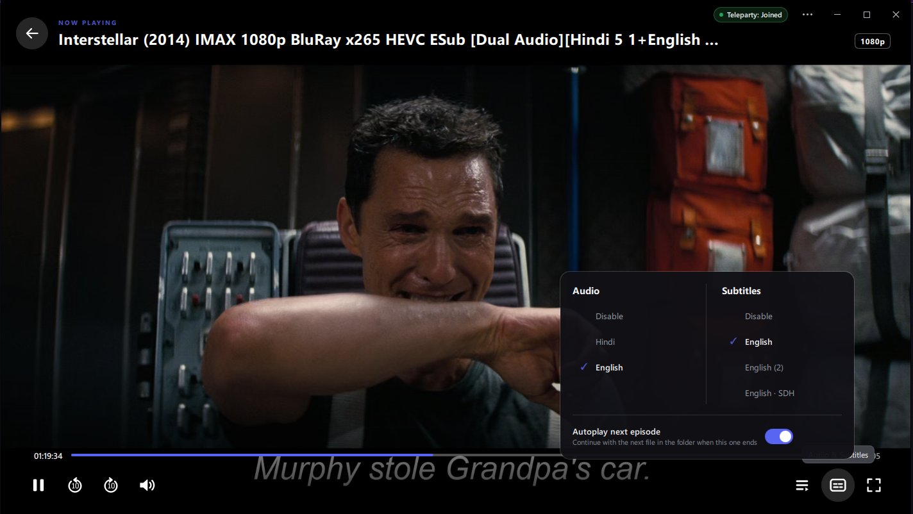
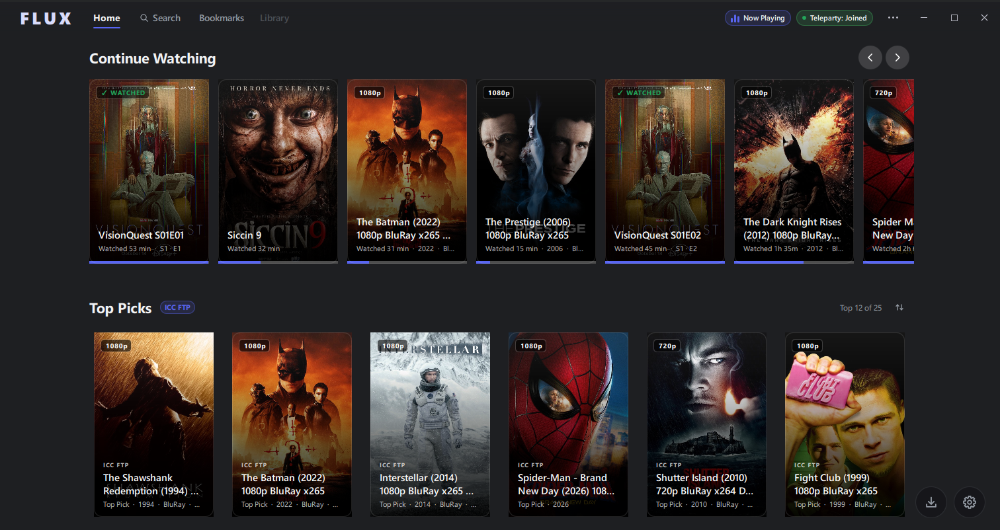
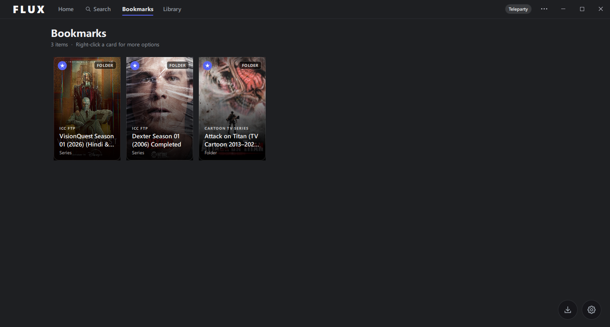
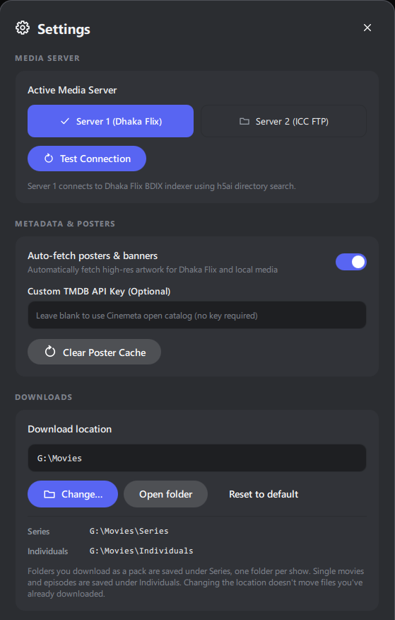
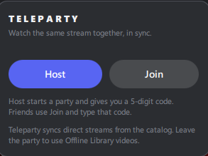
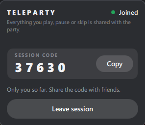

<h1 align="center"><sup></sup>&nbsp;FLUX</h1>

<p align="center">
  <strong>A media browser and player built for BDIX networks.</strong>
</p>

<p align="center">
  Browse your media catalog, play streams, keep a local library, and watch together with friends.
  Built with C++20, Qt Quick and libVLC.
</p>

<p align="center">
  
  
  
  
  
</p>

<p align="center">
  <a href="https://github.com/shifatsrm09/FLUX/releases/latest/download/FLUX-Setup.exe" aria-label="Download FLUX setup installer">
    
  </a>
</p>

<p align="center">
  <a href="https://github.com/shifatsrm09/FLUX/releases/latest">All Releases &amp; Portable (.zip)</a>
  · <a href="#features">Features</a>
  · <a href="#a-look-around">A look around</a>
  · <a href="#teleparty">Teleparty</a>
  · <a href="#build-from-source">Build from source</a>
</p>

<br>

<p align="center">
  
  <br><sub><strong>Watch your way:</strong> direct-stream playback, selectable audio and subtitles, and shared viewing.</sub>
</p>

<h1 align="center">A Look Around</h1>

<table>
<tr>
<td width="50%" valign="top">
  
  <p align="center"><sub><strong>Home</strong><br>Search, continue watching, and browse media categories.</sub></p>
</td>
<td width="50%" valign="top">
  
  <p align="center"><sub><strong>Bookmarks</strong><br>Keep saved movies and folders together.</sub></p>
</td>
</tr>
<tr>
<td width="50%" valign="top">
  
  <p align="center"><sub><strong>Downloads</strong><br>Track active transfers and review download history.</sub></p>
</td>
<td width="50%" valign="top">
  
  <p align="center"><sub><strong>Settings</strong><br>Manage downloads, viewing cache, and library folders.</sub></p>
</td>
</tr>
</table>

<h1 align="center">TELEPARTY</h1>

<p align="center">
  <strong>Host a room or join a friend with a five-digit code. Once connected, direct-stream playback is shared
with the party.</strong>
</p>

<table align="center" width="100%" style="width:100%; table-layout:fixed; margin-left:auto; margin-right:auto">
<tr>
<td width="50%" style="width:50%" valign="top">
  
  <p align="center"><sub><strong>Join or host</strong><br>Start a room or enter the code shared by a friend.</sub></p>
</td>
<td width="50%" style="width:50%" valign="top">
  
  <p align="center"><sub><strong>Connected room</strong><br>Share the room code and watch together.</sub></p>
</td>
</tr>
</table>


## Overview

FLUX brings media discovery and playback into one desktop app. Browse a categorized catalog, pick up
where you left off, save favorites, and download media for offline viewing. When you want company,
start or join a Teleparty room and keep direct-stream playback in sync.

FLUX is designed around BDIX-connected media sources. Availability and streaming speed depend on
your network and the source you use.

## Features

- **Browse and search:** Explore a catalog organized by category and find movies, shows, and episodes.
- **Continue watching:** Return to recent playback with saved progress.
- **Bookmarks:** Keep favorite videos and folders close at hand.
- **Playback controls:** Use seeking, audio and subtitle track selection, fullscreen, and episode
  playback controls powered by libVLC.
- **Offline library:** Download individual videos or folders, resume supported partial downloads,
  and browse downloaded media without a network connection.
- **Viewing cache:** Recently watched streams can be cached automatically, with a 10 GB limit and
  controls to inspect or clear the cache.
- **Watch together:** Host or join a five-digit, Syncplay-backed Teleparty room. Playback sync is for direct streams;
  offline Library playback is unavailable while in a party.
- **Automatic updates:** FLUX checks GitHub Releases for newer versions and provides an in-app update flow.


## Install

Download the latest Windows build from [GitHub Releases](https://github.com/shifatsrm09/FLUX/releases).
Release packages include the FLUX executable and its runtime dependencies. Extract the package and
launch `FLUX.exe`.

## Build from source

### Requirements

- Windows x64 and Visual Studio 2022 C++ build tools
- CMake 3.20 or newer
- Qt 6.5 or newer with Core, Gui, Qml, Quick, Quick Controls 2, and Network
- The libVLC development files under `third_party/vlc` (headers and import libraries)
- A VLC installation for the libVLC runtime DLLs and plugins

Configure the Qt installation path, then build:

```powershell
cmake -S . -B build -DCMAKE_PREFIX_PATH="C:/Qt/6.8.0/msvc2022_64"
cmake --build build --config Release --target FLUX
```

Adjust `CMAKE_PREFIX_PATH` to match your Qt installation. To launch the build, run
`build/Release/FLUX.exe`. If Qt runtime files are not already beside the executable, deploy them
with `windeployqt --qmldir qml build/Release/FLUX.exe`.

## Currently Supported Platforms

| Platform | Status |
|----------|--------|
| Windows  | ✅ Available |
| Android  |  In Development |
| Linux    |  In Development |
| iOS      |  😭 😭 |
